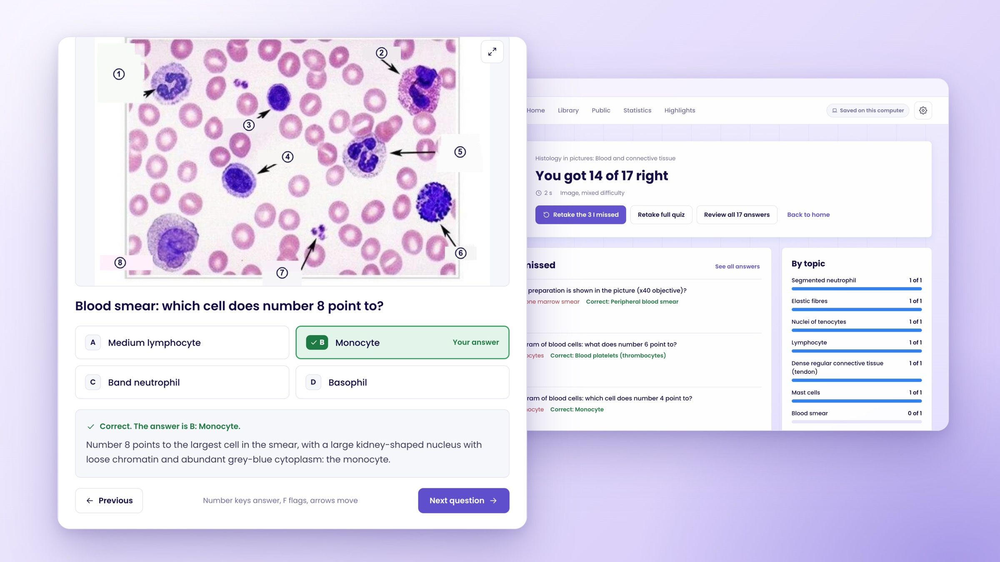
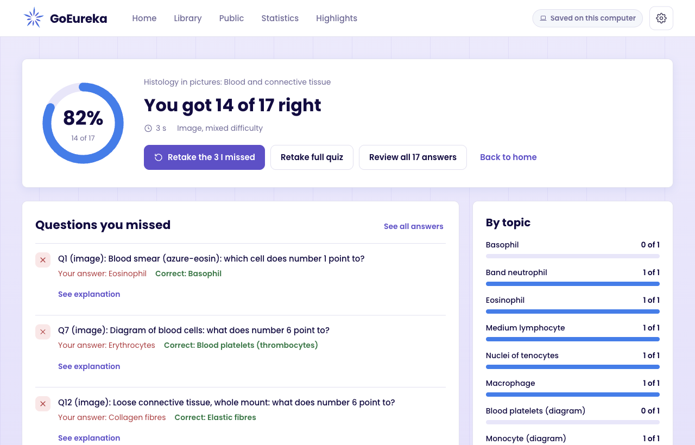
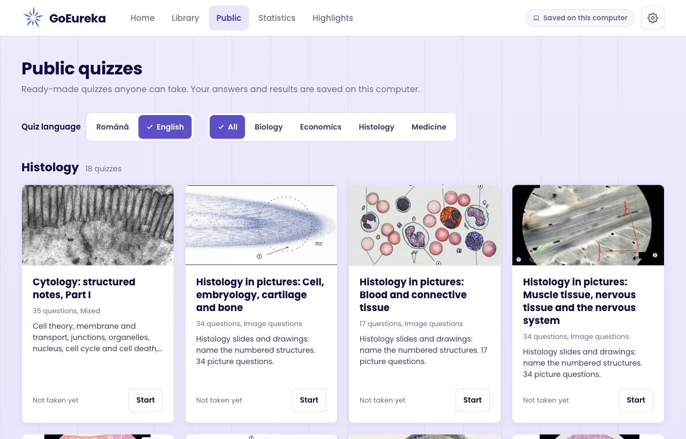
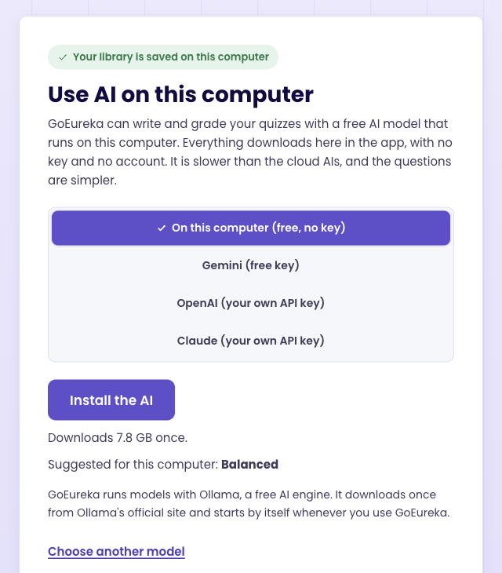

# GoEureka

### Turn your lecture notes into quizzes that explain every mistake.

A free study app for Windows and Mac. Add your slides, PDFs and notes, and GoEureka writes the questions, checks your answers and shows you why, using your own material.

**[Download the latest version](../../releases/latest)** &nbsp;&nbsp;|&nbsp;&nbsp; [Use it in your browser](https://goeureka-omega.vercel.app) &nbsp;&nbsp;|&nbsp;&nbsp; Free, private, no ads

 

 

## Why it works

Rereading feels like studying. You recognise the page, so it feels familiar. In the exam there is no page.

Answering questions makes you pull the facts out of your memory, and that is what makes them stick. GoEureka writes those questions from **your own lectures**, then explains what you got wrong, so you study what your exam is actually about.

## What you get

- **Your material in, a quiz out.** PDFs, PowerPoint slides, Word files, Markdown and photos of your notes. Each file is turned into clean text once and kept in your library. Photos and scanned pages are read on your own computer.
- **Every mistake explained.** Each wrong answer comes with the reason and the part of your material it came from, plus why the answer you picked is wrong.
- **Real exam question types.** Multiple choice with 2 to 8 options, true or false, select all that apply, questions about pictures like diagrams, slides and scans, and written answers that the AI grades.
- **Start right away.** The quiz opens as soon as the first questions pass the checks, and the rest are added while you answer.
- **Make it yours.** Under Advanced, choose how many questions of each type and how many about pictures, how long the written answers and explanations are, and whether the questions spread over the whole file or focus on the main ideas.
- **Your weak spots come back.** Retake only the questions you missed, review any quiz later, and see how you do in every topic on the Statistics page.
- **Highlights.** Select any words in a question or explanation to highlight them. GoEureka collects them by subject and topic.
- **Ready-made quizzes.** 21 public quizzes to start with right away, with 18 histology quizzes full of real microscope pictures, in English and Romanian.
- **In your language.** The app speaks 16 languages, including English, Romanian, Russian, Ukrainian, German, French, Spanish, Italian, Portuguese, Dutch, Polish, Turkish, Hindi, Japanese, Korean and Chinese.

  
  

## A free AI on your own computer, in one click

The desktop app can run its own AI model on your computer. No key, no account, no subscription, and your files never leave your computer.

Setting it up is one button: **Install the AI**. GoEureka downloads the free AI engine ([Ollama](https://ollama.com)) and the model that suits your computer, shows how long is left, and from then on starts and stops it by itself. Nothing to configure and no other website to visit.

  

| Model | Download | Memory | Good for |
|---|---|---|---|
| Light | 4 GB | 8 GB | Short multiple choice quizzes on older laptops |
| **Balanced** (suggested for most) | 7.6 GB | 16 GB | Good questions from most notes |
| Best | 16 GB | 32 GB | The closest to the cloud AIs |

Prefer the cloud? GoEureka also works with your own **Google Gemini** key (free), **OpenAI** key or **Claude** key. The cloud AIs are faster and write sharper questions; the local model is free, private and works offline. With more than one set up, you pick which AI writes each quiz.

## Private by design

- **No account on the desktop app.** Open it and start.
- **Your files stay yours.** Your materials, quizzes and results are saved in `Documents/GoEureka` on your computer. With the local model, nothing leaves your computer at all.
- **No ads, no analytics, no trackers.** GoEureka is free and non-commercial. We never receive your files and never sell anything.

## Download

| Computer | File |
|---|---|
| Windows 10 or 11 | `GoEureka-<version>-windows-setup.exe` |
| Mac with Apple silicon (M1 and newer) | `GoEureka-<version>-mac-arm64.dmg` |
| Mac with Intel | `GoEureka-<version>-mac-x64.dmg` |

Get them from the **[latest release](../../releases/latest)**. Each release lists the checksums of its files in `SHA256SUMS.txt`.

### First start

The app is not signed by Apple or Microsoft yet, so the first start needs one extra step:

- **Windows:** if SmartScreen says "Windows protected your PC", click **More info**, then **Run anyway**.
- **Mac:** open the .dmg and drag GoEureka to Applications. Open it once; when macOS refuses, go to **System Settings > Privacy & Security** and click **Open Anyway**.

Then pick **On this computer** and click **Install the AI**. That one button downloads everything once: the AI engine from Ollama's official release and the model suggested for your computer (about 7.8 GB on a Mac and 9.2 GB on Windows for Balanced). If Ollama is already installed, GoEureka uses that one. **Choose another model** shows the smaller and bigger models.

## Questions

**Is it really free?** Yes. GoEureka is a free, non-commercial project. The local AI is free too. A cloud AI is paid only if you choose OpenAI or Claude and use your own key with them.

**Does it work offline?** Once the AI is installed, yes: making quizzes, taking them and reviewing them all work without internet. Only the optional "More context" lookups need it.

**Is it good for medical students?** It was built with them: picture questions for histology slides, Latin terms kept as they are in your notes, and a ready-made histology collection. Please never upload patient data.

**Do I need a powerful computer?** A laptop with 16 GB of memory runs the Balanced model well, and 8 GB is enough for Light. A 10 question quiz takes about 5 to 10 minutes on a recent laptop with Balanced, and you can start answering after the first few. With a cloud key, any computer works.

 

---

GoEureka is free and non-commercial, made by **NoesisDev**. By using it you agree to the [Terms of use](https://goeureka-omega.vercel.app/terms); see also the [Privacy policy](https://goeureka-omega.vercel.app/privacy).

This repository only holds the installers. Questions, ideas or problems: write to [noesis.devs@gmail.com](mailto:noesis.devs@gmail.com) or [open an issue](../../issues).
